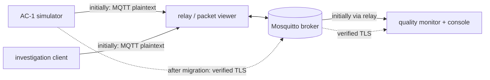

# Lab 3 — Secure the AC-1 MQTT installation without losing the service

## The situation

> *"Last time we investigated why a cure record could appear twice after a network fault. This
> morning a different problem appeared: quality control received `CR-301`, marked `PASS`, but
> nobody at autoclave AC-1 can identify the corresponding cure cycle. There was also a reading
> of 999 °C. Find out how these data entered our system, prevent unauthorized access, and
> make sure legitimate production data still reach quality control."*
> — Nora Elissalde, quality manager, Adour Composites

You return to the **same fictional factory and the same autoclave**. In Lab 1 you reconstructed
how equipment data reach an MQTT application. In Lab 2 you followed `CR-250` through MQTT delivery,
session and retry experiments: one logical record could be **delivered twice** even though it
was created only once. This time, ask the opposite question: **could a newly fabricated record
be delivered correctly, all the way to the quality application?**

Your mission is to investigate the incident, secure the existing MQTT installation and establish
that legitimate production still works. You will use the same MQTT viewer and cure-record format
as in Lab 2, with an additional quality console showing what the application receives. As in
previous labs, a packet trace, an application event and a payload claim are different kinds
of evidence.

Only the numbered questions **Q1–Q15** are required; the ◆ extensions are optional. The session
is designed for about three hours. Written answers may use any format. The lab uses deliberately
insecure configurations and demonstration credentials on an isolated classroom Docker network;
use the supplied tests only against this environment.

---

## Preparation

As in Labs 1 and 2, follow [Working environment](../docs/setup.md) if the VM, Docker, or port forwarding is not yet configured.

If Lab 2 is still running, execute `docker compose down` **from `lab2/` on your VM** first:
its viewer uses host port 8080. Then, **from `lab3/` on the VM**, start this lab in its initial,
intentionally insecure state:

```bash
docker compose up -d --build
docker compose ps
./switch.sh open
```

Each lab starts a separate Docker simulation. Stored sessions and `CR-250` from Lab 2 are
not carried over: `CR-250` is used only to compare incidents. The `CR-SIM-...` records
here stand for already completed *fictional* cure cycles on an accelerated classroom
clock, not for industrial curing completed in a few seconds.

The simulated AC-1 is already running. Open at least **two workstation shells** (all student
Python/MQTT commands below run here, not on the VM host):

```bash
docker compose exec workstation bash
```

Keep the two browser windows available:

| Screen | Address on your laptop | What it can establish |
|---|---|---|
| MQTT packet viewer (Labs 1–2) | `http://localhost:8080` | MQTT packets passing through the **plaintext relay**: clients, topics, directions, ACKs and selected protocol fields |
| AC-1 quality console (new) | `http://localhost:8081` | What a **quality application** received and displayed, or rejected when a check is enabled |

From a remote VM, forward **both** ports using VS Code Remote or an SSH tunnel on **your laptop**:

```bash
ssh -L 8080:127.0.0.1:8080 -L 8081:127.0.0.1:8081 <login>@<vm-address>
```

Start `python quality_monitor.py` in workstation shell A during Q1; it serves the quality console
on port 8081. Keep it running until instructed to switch its MQTT transport. The console is not
an independent sensor and cannot authenticate a physical measurement: it shows what this consumer
received. The viewer is also limited: when we later use **direct TLS to the broker**, the
plaintext relay does not see those packets. An empty viewer will **not** prove encryption.



As in Lab 2, the command location matters:

- **VM host, inside `lab3/`:** `./switch.sh ...`, `docker compose ...`, and editing
  `broker/policy.acl` and `sensor/sensor.env`.
- **Inside workstation (`/work`):** `python attack.py`, `python subscribe_probe.py`,
  `python quality_monitor.py`, `python verify_service.py`, `openssl ...` and the offline tests.
- The VM directory `lab3/work/` is mounted as `/work` inside workstation. You can edit the
  student Python file from either side.

These are the MQTT topics involved:

```text
plant/autoclave/AC-1/temperature         current temperature measurements
quality/autoclave/AC-1/cure-records      completed cure records (as in Lab 2)
plant/autoclave/AC-1/maintenance/#       maintenance diagnostics
public/#                                 publicly shareable information in this simulation
```

A cure record includes `record_id`, `batch`, `completed_at`, `recipe`, `max_air_c`,
`min_pressure_bar`, `result`, and the additional `device_id` source **claim**. The simulator
emits `CR-SIM-...` records at intervals. The `device_id` field is supplied by a publisher;
its value alone does not identify the physical device. Likewise, an MQTT **Client ID** selects a
client/session (Lab 2); it does not authenticate that client.

The supplied helpers are ordinary MQTT clients. As in Lab 2, use their outputs as evidence alongside the viewer:

| Program | Role |
|---|---|
| `attack.py` | Sends one synthetic temperature or cure record under a chosen lab account |
| `subscribe_probe.py` | Attempts a subscription and prints the MQTT v5 response |
| `quality_monitor.py` | Subscribes to both production topics and displays application events |
| `verify_service.py` | Independently waits for a **fresh simulated temperature and cure record** |
| `test_validation.py` | Checks your application-validation function without a broker |

For MQTT 5, the presence of `CONNACK`, `PUBACK` or `SUBACK` alone does **not** imply success:
inspect the **reason code**. As in Lab 2, keep separate evidence from the sender, the broker and
the consumer. The viewer's record-text filter can hide `PUBACK`/`SUBACK`, which have no cure-record
ID in their payload; switch to a Client ID filter or clear it when following a control exchange.

The task is to **configure and verify** the installation, not merely to switch profiles.
An ACL file, certificate or successful command is not sufficient evidence by itself: check
that unauthorized operations fail **and** legitimate messages still arrive.

To make one experimental change at a time, the broker has five prepared profiles. A profile is
only the **test environment**; your ACL and client migration are not pre-solved:

| Profile | What it changes |
|---|---|
| `open` | Anonymous clients are accepted |
| `auth` | A password is required; accounts have no topic-specific restrictions |
| `acl` | Passwords plus the topic policy that **you write** |
| `tls` | Your ACL, with both the old plaintext and new TLS listeners available |
| `tls-only` | Your ACL, with only the TLS listener enabled |

`./switch.sh` restarts the broker. Clients may briefly disconnect and reconnect; do not mistake
this effect for a deliberate security refusal. Re-establish the relevant observation after each
profile change.

---

## Part 1 — Investigate the quality incident

### Establish what normal production looks like

In **workstation shell A**, start and leave the consumer running:

```bash
python quality_monitor.py
```

Open the quality console (`8081`) and the packet viewer (`8080`) side by side. A new temperature
appears about every three seconds; a synthetic completed cure record appears roughly every
12 seconds. Locate a `CR-SIM-...` identifier on **both** screens. In the viewer, identify a
publisher-to-broker `PUBLISH` and the broker-to-consumer `PUBLISH`; then locate a corresponding
application event in the console. Inspect at least one payload and compare its fields with the
Lab 2 `CR-250` record.

### Q1 — What evidence do we have before any attack?

For the same normal cure record, distinguish: (i) what the packet trace observed, (ii) what the
quality application displayed, and (iii) what the JSON fields **claim** about the source. Does
any one of those observations prove that an actual AC-1 cycle finished with `PASS`? Relate your
answer to the scope of `PUBACK` established in Lab 2.

### Reproduce the reported anomaly

In **workstation shell B**, run the supplied client **without MQTT credentials**:

```bash
python attack.py --anonymous --record-id CR-301 --result PASS
python attack.py --anonymous --value 999
```

Each command creates **one message** and exits; `attack.py` is not changing the sensor itself.
Look for `CR-301` and `999` in the quality console, then in the viewer. Compare `CR-301` with a
normal cure record: it uses the same topic and business fields, including `device_id=AC-1`.
Follow the attack client's `CONNECT`/`CONNACK`, `PUBLISH`/`PUBACK`, and the application event.

### Q2 — Was this a transport failure or a source-trust failure?

Using concrete evidence, determine whether the broker accepted `CR-301` and whether the quality
application received it. Why is this **not** the duplicate-delivery problem you studied with
`CR-250`? Which part of the fraudulent payload would be easy for an attacker to imitate, and why?

### Check whether the same client can see private data

Still in the `open` profile, try to receive AC-1 measurements without credentials:

```bash
python subscribe_probe.py --anonymous --topic 'plant/autoclave/AC-1/#'
mosquitto_sub -h relay -p 1884 -V mqttv5 -i lab3-guest-read \
  -t 'plant/autoclave/AC-1/#' -C 3 -v
```

The first helper inspects the subscription response; the second listens for three actual
messages. A granted subscription and receipt of data are related, but they are not identical
evidence.

### Q3 — What are the two exposures?

Show evidence for both **unauthorized publication** (Q2) and **unauthorized reading** (this
experiment). Which business operations do they threaten differently? What could a successful
`SUBACK` establish that the received data establish more directly?

### Convert the incident into acceptance criteria

The plant cannot simply turn MQTT off. AC-1 must still publish measurements and cure records;
quality control must still receive both. A visitor should read only public information, and a
maintenance client has a specific diagnostic purpose. Consider both unwanted and legitimate
behaviors before choosing a security control.

### Q4 — How will we know the installation has been secured?

Specify **four observable tests** covering: unknown identity, unauthorized write, unauthorized
read, and continuing production/quality service. For each test, state the client operation, the
expected result and the observation that would justify that result. Which concern from Q2 would
remain unresolved even if all four tests passed?

<details><summary><strong>◆ Going deeper A — Which MQTT identity is which?</strong></summary>

Change the test publisher's **Client ID** in its Python code while leaving the credentials and
payload unchanged. Predict which part of the broker's decision this changes. Compare it with
changing the JSON `device_id`. Explain how client/session identity, authenticated account and
claimed data origin differ. Restore the script afterwards.

</details>

---

## Part 2 — Make access depend on identity **and** topic

A broker can establish a client account at connection time yet still let that account publish
and subscribe everywhere. We will isolate these two decisions experimentally. **Authentication**
asks which account connects; **authorization** asks what that account may do on a given topic.
Neither decision establishes the accuracy of a physical measurement.

### Reject clients without valid credentials

On the **VM host**:

```bash
./switch.sh auth
```

After the broker restarts, try two connections in workstation shell B:

```bash
python attack.py --anonymous --value 998
python attack.py --user visitor --wrong-password --value 998
```

Check the client output and, if the connection reached the relay, the `CONNACK` status. The
helper exits before publishing when the connection is rejected. If a command returns a nonzero
exit code, first determine *where* it failed rather than treating every error as proof of an
ACL denial.

### Q5 — What has changed, and what has not?

For the two attempts, identify the packet or client result demonstrating rejection and locate
the protocol step at which it occurred. Did the broker need to inspect a message's topic to
make this decision? What can you conclude about anonymous access, and what have you **not yet
tested** about accounts with valid passwords?

### Test the remaining gap

The demonstration `visitor` account has a valid password. Without adding a topic policy yet,
repeat the quality-record injection under that identity:

```bash
python attack.py --user visitor --record-id CR-302 --result PASS
```

Compare `CR-302` with the anonymous `CR-301` experiment and the two rejected connections in
Q5. It is possible to authenticate a client correctly and still grant it inappropriate rights.

### Q6 — Is authentication sufficient for this incident?

Does the quality console now contain `CR-302`? From the contrast between Q5 and Q6, determine
which **new kind of decision** the broker must make before forwarding a publication. State
precisely why a valid password is not evidence that the message came from AC-1.

### Design the permissions from business responsibilities

You have four demonstration accounts, with distinct responsibilities:

- **`ac1`** produces its temperature and completed cure-record data; it does not need to read
  other factory topics.
- **`quality`** consumes those two streams; it is not a producer.
- **`visitor`** may consult information intentionally published under `public/#`, not production
  measurements or quality records.
- **`maintenance`** reads the AC-1 temperature for diagnostics and publishes maintenance
  status under `plant/autoclave/AC-1/maintenance/#`; it must not issue quality records.

A **Mosquitto access-control list (ACL)** associates permissions with an authenticated username,
not with a JSON field. Its useful statements in this lab have the form:

```text
user <account>
topic read <topic-or-filter>
topic write <topic-or-filter>
```

Here `read` permits matching deliveries/subscriptions and `write` permits publication; an
unmatched operation is denied. Reuse the MQTT topic levels and wildcards studied in Lab 1.
For example, `topic read public/#` grants a subscriber the publicly designated hierarchy —
**not** the whole broker. The starter file `broker/policy.acl` deliberately leaves the
production permissions incomplete.

### Q7 — Design and implement the least-privilege policy

**Before editing**, produce a small **read/write matrix** from the responsibilities above.
Choose exact topics where an account has no need for a wildcard; justify the maintenance
wildcard separately. Then edit `broker/policy.acl` **on the VM host** to implement your matrix.
Avoid blanket rules such as `topic readwrite #`.

Apply the policy:

```bash
./switch.sh acl
docker compose logs --tail=35 broker
```

The broker reads the ACL when it starts. A syntactically accepted policy can still be **wrong**:
for example, omitting AC-1's permission can break the plant even though it blocks an attacker.
How could you detect that failure using the sensor log or the quality console? Which ACL
property would you expect to remain unchanged if someone edits the JSON `device_id`?

### Test denied operations independently

Workstation shell B:

```bash
python attack.py --user visitor --record-id CR-303 --result PASS
python subscribe_probe.py --user visitor --topic 'plant/autoclave/AC-1/#'
python attack.py --user maintenance --value 995
```

A `PUBACK` may carry an MQTT 5 failure reason; a `SUBACK` may reject a requested subscription.
If a publication is rejected, there should also be **no new matching quality event**. Use a
Client ID filter (or no filter) in the viewer to see control packets, and inspect the broker
log if the result is ambiguous:

```bash
# VM host
docker compose logs --tail=45 broker
```

### Q8 — Which negative tests actually passed?

For each operation, report whether a connection was accepted, whether the requested
publication/subscription was allowed, and what the separate application observation shows
when relevant. Include at least one concrete `PUBACK`/`SUBACK` reason or broker-log line.
If something is unexpectedly accepted, use your policy to explain and correct it; do not simply
repeat the command until it fails.

### Confirm normal production, not just attack prevention

The broker may now be restrictive enough to block everything. Test allowed operations too:

```bash
python attack.py --user ac1 --value 181
python subscribe_probe.py --user quality --topic 'plant/autoclave/AC-1/temperature'
python subscribe_probe.py --user visitor --topic 'public/#'
python attack.py --user maintenance \
  --topic 'plant/autoclave/AC-1/maintenance/status' --value 1
python verify_service.py
```

`verify_service.py` opens an **independent quality subscription** and waits for *new*
`CR-SIM-...` and temperature messages from the simulated sensor. Its success does not prove
physical authenticity, but it does verify that the intended data flows still reach a consumer.
The maintenance test writes to a diagnostic topic, **not** to the quality application: inspect
its `PUBACK`, not the console, to determine whether the broker allowed it.

### Q9 — Can you defend the policy as operational?

Combine the denied operations from Q8 and the authorized operations above in a compact **denied/allowed test matrix**. Explain why a denied visitor
publication *alone* would be insufficient evidence of a successful deployment. If the service
test fails, localize the fault: failed connection, missing publish permission, missing read
permission, or unavailable producer. State which log or MQTT exchange would distinguish the
possibilities. Repair the policy before moving on.

<details><summary><strong>◆ Going deeper B — The cost of one permissive rule</strong></summary>

Back up your ACL. Deliberately broaden **one** permission for `visitor`, reload the `acl`
profile, and predict which previously failing test will now pass. Test your prediction, then
restore the least-privilege policy and repeat a denied **and** a legitimate access test.

</details>

---

## Part 3 — Protect the transport **without losing the service**

So far, credentials and permissions restricted MQTT operations, but the MQTT packets passing
through the plaintext relay were still readable there. We will now change the connection,
not the topic names or business payloads.

A TLS connection provides confidentiality and integrity **between this MQTT client and the
broker** when correctly negotiated and verified. The client must also authenticate the server:
a TLS handshake to an arbitrary endpoint is not enough. In this lab, a teaching certificate
authority (CA) issued a certificate for the Docker hostname **`broker`**. The public CA
certificate is available inside workstation as `/work/ca.crt`. The broker uses a private key
provided in this isolated teaching repository; distributing a production private key this way
would be unacceptable. Generating and managing production certificates is outside this lab.

A safe operational sequence is **enable the new interface → test it → migrate producers and
consumers → verify business service → retire the old interface**. These Compose profile changes
restart the broker, so a short reconnection is expected; this laboratory does **not**
demonstrate zero-downtime maintenance.

### Inspect what the current protection leaves exposed

Keep the `acl` profile active. Send an ordinary authorized publication:

```bash
python attack.py --user ac1 --value 182.5
```

Find that publication and a regular `CR-SIM-...` record in the plaintext viewer. The viewer
can display their topic, source claim, quality result and some payload fields, even though an
ACL is now active.

### Q10 — What can the observer learn on this link?

Identify **two business details** visible from the packet trace that someone positioned on
this plaintext network segment could learn. Does successful password authentication conceal
the contents? What precise problem would TLS solve, and which problem from Q2 would it leave
untouched?

### Bring up a parallel TLS interface

On the **VM host**:

```bash
./switch.sh tls
```

This profile keeps the old plaintext listener and introduces TLS at `broker:8883`. From
workstation, use `openssl s_client` to inspect the server certificate. The following is a
**diagnostic command**, not a way to send MQTT messages:

```bash
openssl s_client -connect broker:8883 -CAfile /work/ca.crt \
  -verify_hostname broker -verify_return_error -brief </dev/null
```

`-CAfile` supplies the trusted issuer, and `-verify_hostname` checks the expected server name.
Now repeat the test with `-verify_hostname not-broker`. Pay attention to the certificate
verification result, not just to the fact that a socket opened. Do **not** disable verification
to make a failed test pass.

### Q11 — What does the certificate test actually establish?

Contrast both handshake attempts. Separate the evidence that (i) the certificate chains to the
trusted teaching CA and (ii) it is valid for the **intended endpoint name**. Why is the server
name relevant even when the connection is encrypted? Does that test establish the identity or
measurement accuracy of AC-1 itself?

### Test the new path before retiring the old one

Stop the plaintext quality monitor in shell A (`Ctrl+C`), then restart it with TLS:

```bash
python quality_monitor.py --tls
```

Refresh the same quality console on port 8081. In another workstation shell, compare two
publications, changing **only the transport selected by the helper**:

```bash
python attack.py --user ac1 --tls --value 183.5
python attack.py --user ac1 --value 184.5
```

The first publishes directly to `broker:8883` with certificate verification. The second
still uses the old plaintext relay. Verify which measurements the TLS quality application
receives. The viewer can observe the second flow but not the first: it is not a TLS packet
analyzer.

### Q12 — Is making TLS available the same as requiring TLS?

What do the two successful publications reveal about the current deployment? What evidence
shows the first client verified the intended server, rather than merely reaching some TCP
port? Why must the old listener **not** be removed yet? Explain your answer using the
currently running AC-1 sensor rather than a generic security slogan.

### Migrate the original producer

Until now, only the test client and quality consumer have used TLS. The actual AC-1 simulator
still publishes through the plaintext relay. On the **VM host**, inspect
`sensor/sensor.env`: its `MQTT_TRANSPORT`, `MQTT_HOST` and `MQTT_PORT` describe the current
endpoint. Using the verified TLS endpoint established in Q11–Q12, **choose and set their new
values**. Keep `MQTT_CA_PATH` unchanged. Do not switch to `tls-only` before the producer works
on TLS.

Apply the edited `env_file` by **recreating** the producer container; restarting an existing
container is not sufficient to load changed Compose environment values:

```bash
# VM host, in lab3/
docker compose up -d --no-deps --force-recreate sensor
docker compose logs --tail=35 sensor
```

Then independently test the quality flow in workstation:

```bash
python verify_service.py --tls
```

The sensor log reports its effective transport and endpoint. The service check waits for a
*new* temperature and *new* completed cure record; it cannot be satisfied merely by
publishing a single test value with `attack.py`.

### Q13 — What proves that the producer has actually migrated?

Report the three connection parameters you changed and **why** they correspond to the
verified server. Use at least two *independent* pieces of evidence: one about the sensor's
connection and one about delivery to the quality consumer. If the check fails, distinguish
connection/CA problems from a missing topic permission. What short interruption is expected
during the container recreation?

### Retire plaintext only after the new path is working

When Q13 succeeds, on the **VM host**:

```bash
./switch.sh tls-only
docker compose logs --tail=35 broker sensor
```

In workstation, compare four outcomes:

```bash
python attack.py --user ac1 --value 185.5
python attack.py --user ac1 --tls --value 185.5
python attack.py --user visitor --tls --value 996
python verify_service.py --tls
```

The first probe intentionally uses the **old relay**: it may fail with a connection error or
timeout instead of an MQTT-level reason code, because no plaintext broker listener remains.
The visitor probe reaches the TLS listener but should still be denied by your ACL. If
`verify_service.py` fails, check both broker and sensor logs rather than assuming TLS is the
cause. Revisit whether the sensor container was recreated with the edited environment.

### Q14 — Can you demonstrate the required protections **and continued operation**?

Give a four-row final verdict for (i) plaintext client, (ii) permitted TLS publication,
(iii) forbidden TLS publication and (iv) AC-1 → quality delivery of **both** business flows.
For each, identify the relevant evidence and the mechanism responsible for the result. Why
would the ability to connect over TLS **alone** be a poor deployment acceptance test? What
would you investigate if measurements resumed but cure records did not?

<details><summary><strong>◆ Going deeper C — Diagnose a failed cutover</strong></summary>

Temporarily set an invalid `MQTT_HOST` in `sensor/sensor.env`, recreate the sensor and inspect
its logs. Compare the symptoms with a certificate hostname mismatch in `openssl s_client`.
Restore the real TLS endpoint and demonstrate renewed service with `verify_service.py --tls`.

</details>

---

## Part 4 — Secure channel, plausible payload, real measurement?

The deployment now rejects unpermitted accounts and plaintext access, and the quality
application still runs. However, the lab's demonstration credentials for `ac1` are known.
Treat the next client as a **faulty or compromised authorized producer**, not as an attacker
who has broken TLS. The incident tests a different trust boundary.

### Start with the remaining failure

With `tls-only` active and the TLS quality monitor still running, execute:

```bash
python attack.py --user ac1 --tls --value 999
```

Observe its `PUBACK` and the result in the quality console. A value can be delivered by a
client with the correct account permissions over a verified TLS connection and still be
physically implausible. Think about which component would have enough context to screen it.

We will implement **one deliberately narrow check**, not a full industrial quality system.
For the simulated AC-1, the application decides to display temperatures only when they are
numeric, finite, associated with claimed `device_id="AC-1"`, and within the **assumed classroom
interval of 160–200 °C**. This is an application policy, **not** an industrial safety limit.
A JSON message may also be malformed, not an object, or missing a required field.

The starter function `assess(data)` in `work/validate_student.py` should return
`(accepted: bool, reason: str)` for an already decoded JSON value. Use
`python test_validation.py` to inspect eight nominal and invalid cases before and after your
implementation. In Python, remember that `True` is an instance of `int`: decide whether it
belongs in a temperature field. A nonfinite number such as infinity is not a valid physical
measurement, even if some parsers accept it. Do not allow an invalid value to crash the monitor.

Once the offline tests pass, stop the quality monitor and restart it **with validation**:

```bash
python quality_monitor.py --tls --validate
```

From another workstation shell, run these three **distinct** observations:

```bash
python attack.py --user ac1 --tls --value 180
python attack.py --user ac1 --tls --value 999
python attack.py --user ac1 --tls --record-id CR-399 --result PASS
```

The new validator applies to **temperature messages**, not to a whole-cycle cure record.
The console shows `REJECTED` for a screened-out temperature and `UNVERIFIED` for cure
records: `UNVERIFIED` is not an authentication judgment and not necessarily a rejection.

### Q15 — Which risks did the filter address, and which remain?

Complete `assess()` and provide evidence from the offline test and two live temperatures.
Explain why the accepted value `180` is **plausible but not physically proven**. Compare
`CR-399` with `CR-301`: what changed in the attacker's MQTT rights, and what remains the
same about the difficulty of verifying a completed cure event? Propose **one additional
practical safeguard** for a future industrial design, identify the threat it reduces, and
state a limitation. Do not claim that a range check provides physical attestation.

<details><summary><strong>◆ Going deeper D — Replay and business-event consistency</strong></summary>

Consider (without implementing a whole audit system) a timestamp freshness check and
persistent tracking of `record_id` or sequence numbers. Which of these would help with the
`CR-250` duplicate? Which might detect a replayed `CR-399`? Could a client holding valid
credentials simply invent a new timestamp or record ID? Explain the remaining trust assumption.

</details>

---

## Handover: what can the factory now claim?

The target final state is a working **TLS-only broker**, migrated AC-1 producer, operating
quality consumer, documented least-privilege ACL, and a tested temperature filter. Preserve
four short pieces of evidence: the original incident; the ACL with negative **and** positive
tests; the TLS cutover and two-topic service check; and the validator's effect and limits.
There is no compulsory report template.

For the architecture lab, the unresolved question is **how to establish the provenance and
consistency of a quality record for an entire cure cycle**, while preserving operation during
network and equipment failures. Your experience with `CR-250` (delivery duplicate), `CR-301`
(unauthorized newly fabricated record) and `CR-399` (fabrication under authorized credentials)
points to **different engineering controls**, not one universal MQTT setting. If useful,
record those constraints and your decisions in the **optional** `../record/site-architecture.md`.

