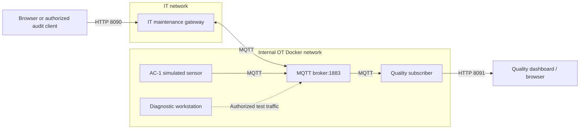

# IT/OT security testbed — Adour Composites

This directory contains an **independent, containerized IT/OT testbed** intended for practical security assessment after Labs 1–4. It is **a runnable infrastructure, not a project assignment**. No AI framework, external LLM, attack agent, or assignment-specific file is required to start or operate it.

The simulated AC-1 equipment publishes synthetic measurements and cure records. The HTTP services, MQTT broker, authentication rules, Docker networks and packet exchanges are real software services. **No physical industrial equipment is connected or controlled.** This stack is isolated from the four labs and uses different host ports.

## Architecture



The `gateway` joins the IT and OT Docker networks. The broker and sensor are attached only to the **internal OT network**. The `quality` service also serves an observation-only web interface. The `workstation` is connected directly to OT as a privileged diagnostic container; it does **not** represent an ordinary IT user. The diagram shows the logical traffic and trust boundaries, not a physical industrial topology.

| Compose service | Role | VM host access |
|---|---|---|
| `broker` | Mosquitto with demonstration accounts and ACL | No broker port published |
| `sensor` | Synthetic AC-1 measurements and cure records | No published port |
| `gateway` | IT-facing maintenance web/API; MQTT client | `127.0.0.1:8090` by default |
| `quality` | OT subscriber and read-only dashboard | `127.0.0.1:8091` by default |
| `workstation` | Local diagnostic and regression tools | `docker compose exec` |
| `capture` | Optional PCAP capture of gateway's MQTT interface | Compose profile `capture` |

## Requirements and start

Use a dedicated Ubuntu teaching VM or another isolated host with Docker and the Compose plugin. Do not run on a shared production network. **Do not expose the intentionally insecure web/API surface to the public Internet.**

From `iot-labs/security-project/`:

```bash
cp .env.example .env
docker compose up -d --build
docker compose ps
./scripts/doctor.sh
```

Open the interfaces on the VM at <http://localhost:8090> (IT) and <http://localhost:8091> (quality observations). If the VM is remote, forward both ports from your laptop:

```bash
ssh -L 8090:127.0.0.1:8090 -L 8091:127.0.0.1:8091 LOGIN@VM
```

The host binding defaults to `127.0.0.1` in `.env.example`. If a separately hosted audit VM must access the IT service, use an instructor-approved private IP and restrict the firewall to the authorized source. Never expose the vulnerable service to the campus at large.

The sensor publishes periodically. You can change `SENSOR_SITE_TAG` or `SENSOR_PERIOD` in `.env` and recreate the service with `docker compose up -d --no-deps --force-recreate sensor`. These are test parameters, not proof of authenticity.

## What is ready to use?

**No code needs to be completed.** All services run with their supplied implementations.
The `app/` directory contains the running applications. `broker/` contains MQTT
configuration, and `control/` stores the active demonstration mode. The
`diagnostics/` directory contains ready-made regression and inspection programs,
not student exercises or incomplete code. They run in the `workstation` container. The
`captures/` directory holds optional generated PCAP files (not tracked by Git).

The supplied profiles deliberately differ in access rights. The `vulnerable`
profile is the **default**, and it is only appropriate on an isolated teaching VM.
The `hardened` profile is a comparative example, **not a production-secure OT
architecture**: demonstration passwords and plaintext MQTT still exist.
Neither profile requires third-party audit software.

## Observe and verify

The IT gateway provides a browser interface and JSON endpoints. The quality service provides an independent dashboard showing **messages actually received by the OT consumer**. HTTP status codes and MQTT acknowledgements should not be confused with application delivery.

The infrastructure supplies a deliberately permissive demonstration profile and a restricted reference profile. To compare their behavior:

```bash
./mode.sh vulnerable
./scripts/doctor.sh
./mode.sh hardened
./scripts/doctor.sh
./mode.sh vulnerable
```

`./scripts/doctor.sh` checks the active profile using real HTTP and MQTT exchanges. For a complete deployment check on the actual VM, run `./scripts/acceptance.sh`; it checks both profiles and restores the permissive profile. Run it **only inside the authorized isolated test environment**. These checks validate the software path, not a physical autoclave.

To capture traffic on the **gateway-to-broker** connection:

```bash
mkdir -p captures
docker compose --profile capture up -d capture
# Interact with the web interface, then stop the capture:
docker compose --profile capture stop capture
```

Inspect `captures/mqtt.pcap` with a PCAP viewer. The capture does not cover all OT traffic. It may include plaintext demonstration credentials; do not publish captures or commit them to Git.

## Maintenance and reset

Changes in `app/*.py` require a rebuild/recreate of the affected container, for example:

```bash
docker compose up -d --build --no-deps --force-recreate gateway
```

Changes to MQTT ACL files require `docker compose restart broker`. The infrastructure health checks are in `scripts/`; supporting Python programs
are in `diagnostics/`. For example, `diagnostics/smoke.py` waits for fresh traffic,
so an old displayed event cannot be mistaken for current service availability.
To inspect the broker directly, use:

```bash
docker compose exec workstation python /diagnostics/mqtt_probe.py --seconds 10
```


```bash
docker compose down                      # Stop without deleting source files
./scripts/reset.sh                       # Reset demo profile and remove test PCAP
docker compose up -d --build             # Start again
```

`reset.sh` does **not** restore modified Python source code. Use Git to discard intentional local code changes when necessary.

## Scope and limitations

- The deliberately weak and restricted configurations are **teaching references**, not production security baselines. Demonstration passwords are visible in the source code.
- The default MQTT link is plaintext. Do not infer transport confidentiality or trusted physical provenance from successful MQTT delivery.
- The IT/OT link is an *application-level* HTTP-to-MQTT path. No PLC, Modbus endpoint, safety controller or physical actuator is present. Do not presume an XSS, RCE or command-injection vulnerability without testing.
- Specialized audit tools, AI services and assessment procedures are selected **outside this repository** by the teaching team.
- All experiments must remain on isolated, explicitly authorized systems.
